# dsh-markdown-studio

[简体中文](./README.md) | **English** | [Developer and architecture guide](./docs/DEVELOPMENT.md)

[](https://github.com/Geekhyt/dsh-markdown-studio/actions/workflows/ci.yml) [](https://www.npmjs.com/package/dsh-markdown-studio) [](./LICENSE) [](./package.json)

**Write clean Markdown. Copy publication-grade WeChat Official Account layouts in one click.**

`dsh-markdown-studio` (Markdown Studio) is a local-first Markdown writing and WeChat Official Account typesetting studio built natively for DeepSeek Harness. Write standard Markdown on the left, preview mobile and desktop layouts in real time on the right across 8 original themes or your own named CSS themes, optionally polish selected passages with custom Writing Skills and inline red/green diff review, and copy ready-to-paste rich HTML for WeChat Official Accounts in one click. Every draft, image, and custom theme stays on your machine — **no sign-in, zero telemetry, zero cloud lock-in** (only passages you explicitly submit to a Writing Skill are processed by your configured host model).

## Quick start

**Option 1: Install directly inside DeepSeek Harness (recommended, no terminal or restart needed)**

Open **Plugins** in the left sidebar, click **Add plugin**, enter `dsh-markdown-studio`, and choose **Enable now**. Then open **Markdown Studio** from the left sidebar.

**Option 2: Install via CLI**

```bash
dsh plugin --profile desktop add dsh-markdown-studio
```

To install from a local clone instead, run `npm ci && npm run build` and then `dsh plugin --profile desktop add link:.`. To upgrade later, run `dsh plugin --profile desktop add dsh-markdown-studio@latest`; to uninstall, run `dsh plugin --profile desktop remove dsh-markdown-studio`.

<details>
<summary><strong>Click to expand 5 ready-to-paste Markdown and custom theme snippets</strong></summary>

1. **Editorial blocks (`:::lead` / `:::tldr` / `:::pull` / `:::meta` / `:::sign`), five-tone callouts, and inline highlights**:
   ```markdown
   :::meta Deep Dive · 5 min read

   :::lead
   Supports ==inline highlights==, ++underlined key phrases++, and automatic bottom [reference footnotes](https://github.com/Geekhyt/dsh-markdown-studio).
   :::

   :::tldr
   - Executive takeaways styled automatically in each theme's editorial voice
   :::

   :::pull Great typesetting tools amplify prose without locking in your source files.

   > [!TIP] Editorial Callout
   > Consecutive `[!NOTE]`, `[!TIP]`, `[!IMPORTANT]`, `[!WARNING]`, and `[!CAUTION]` blocks compile into independent styled callout cards.

   :::sign 2026 · Markdown Studio Editorial Desk
   ```
2. **Vertical and horizontal WeChat scroll containers (`:::scroll` / `:::scroll-x`)**:
   ```markdown
   :::scroll 260
   Keep long changelogs, dense tables, or reference blocks inside a fixed-height scrollable box in WeChat articles.
   :::

   :::scroll-x
   
   
   :::
   ```
3. **Self-contained vector equations (paste cleanly into WeChat without missing glyphs)**:
   ```markdown
   Inline $E = mc^2$ and display Gaussian integral:

   $$
   \int_{-\infty}^{+\infty} e^{-x^2}\,dx = \sqrt{\pi}
   $$
   ```
4. **Theme-aware Mermaid diagrams**:
   ````markdown
   ```mermaid
   flowchart LR
     MD["Clean Markdown"] --> COMP["Theme Compiler"] --> MP["WeChat Rich HTML"]
   ```
   ````
5. **Named custom CSS theme (click Settings → Theme presets → **New theme** to open the left CSS Workbench, paste, and save)**:
   ```css
   .mdstudio-content {
     --mdstudio-accent: #0d9488;
     --mdstudio-bg: #f4fbfa;
     --mdstudio-quote-bg: #e6f7f5;
   }
   .mdstudio-content h2 {
     border-bottom: 2px solid #0d9488;
     padding-bottom: 6px;
   }
   ```

</details>

## See it in action

### Split-pane writing with live mobile and desktop preview

Write clean Markdown with `/` slash commands, Notion-style conflict-free shortcuts (`⌘/Ctrl + Shift + E` inline math, `⌘/Ctrl + Alt + 4` task list, `⌘/Ctrl + Alt + -` divider — full cheat sheet in **Settings → Help**), document outline jump, and find & replace. Switch between mobile card and desktop full-width previews with bidirectional scroll sync, then press `⌘/Ctrl + Enter` to copy for WeChat.

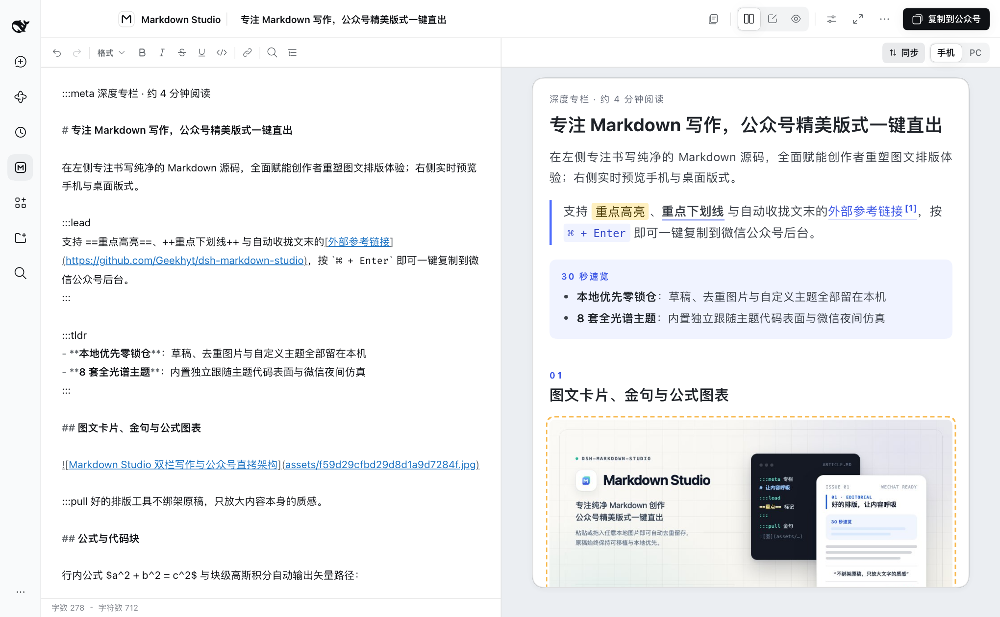

### 8 full-spectrum built-in themes and Custom CSS Workbench

Switch across 8 original editorial presets (**Classic, Gallery, Insight, Botanical, Noir Gold, Anthology, Briefing, Poster**) and 8 independent code-highlighting palettes. Click **New theme** to author, name, and manage multiple custom CSS themes in a dedicated left-pane CSS Workbench that extracts live color swatches into the **Theme presets** grid (or download and open the standalone [8-Theme Interactive Preview Gallery](./docs/theme-gallery.html) locally).

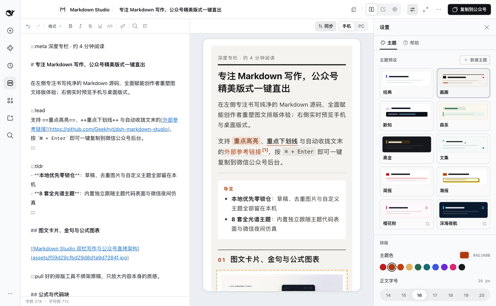

#### Real-device mobile WeChat previews across all 8 built-in themes

The exact same clean Markdown draft rendered across all 8 built-in editorial themes on a mobile WeChat reading screen (lead callouts, TL;DR headers, chapter badges, and code surfaces adapt automatically per theme):

| Classic · 经典 | Gallery · 画廊 | Insight · 新知 | Botanical · 森系 |
| :---: | :---: | :---: | :---: |
| 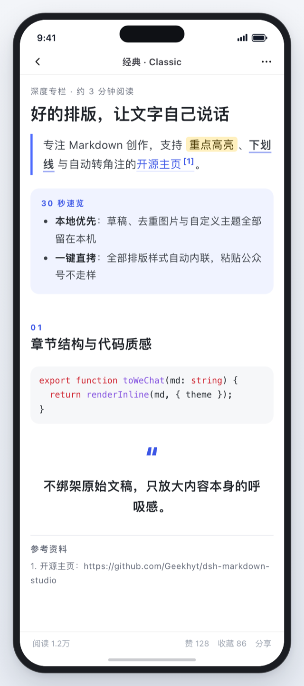 | 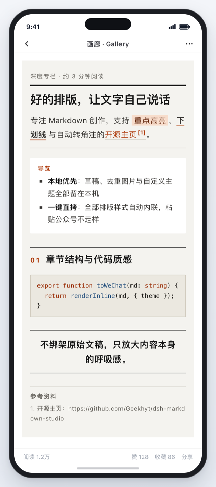 | 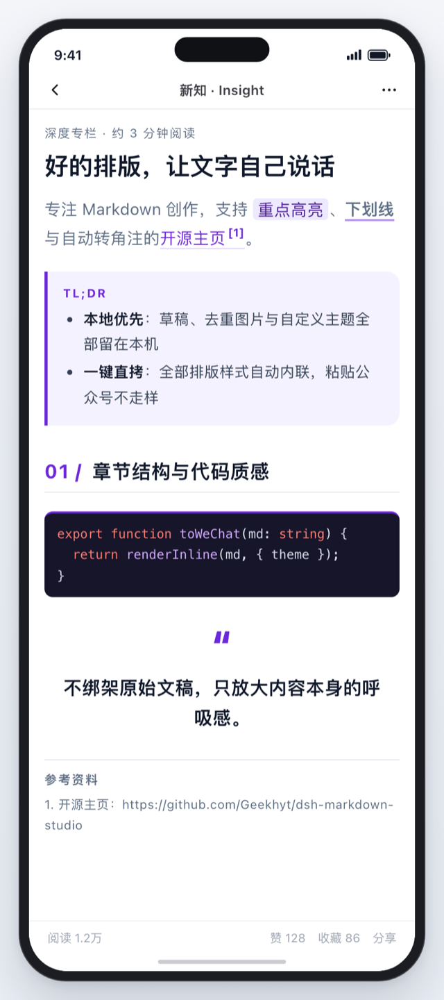 | 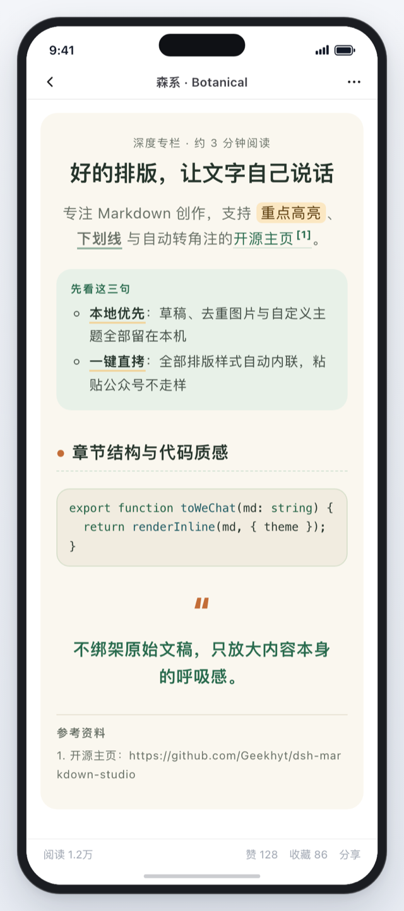 |
| Crisp blue accent · `01` overline badge | Museum stone paper · bold crown rule | `01 /` violet sections · deep-indigo code | Warm oat stationery · `●` dotted rule |
| **Noir Gold · 黑金** | **Anthology · 文集** | **Briefing · 简报** | **Poster · 海报** |
| 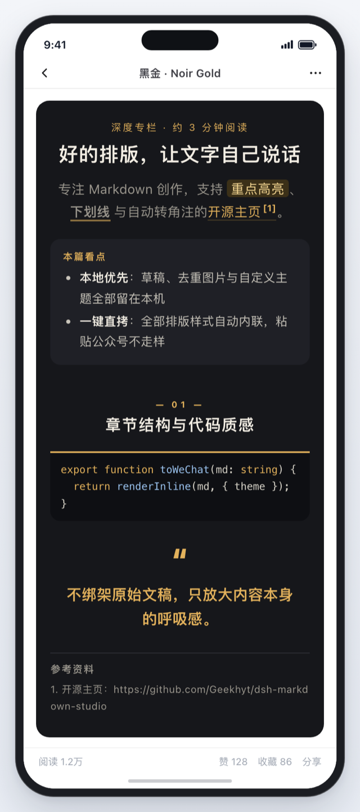 | 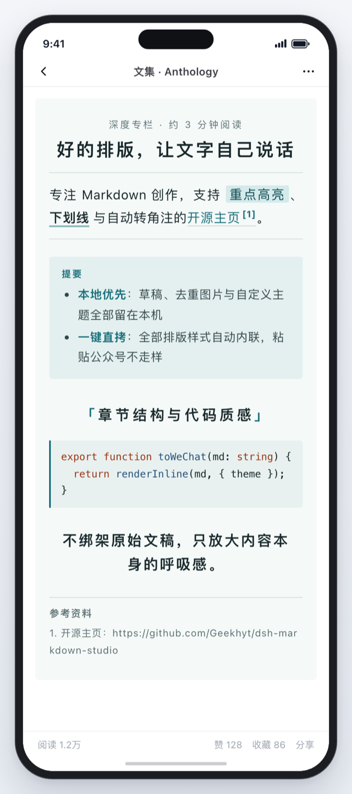 | 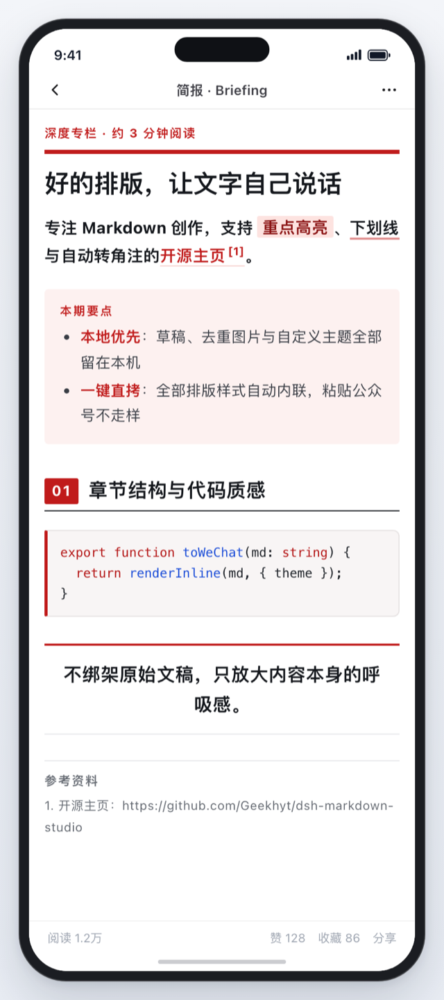 | 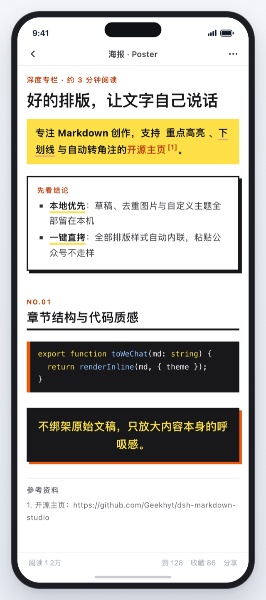 |
| Obsidian dark · champagne-gold chapters | Celadon bookleaf · `「」` chapter brackets | Crimson top rule · `[01]` square seal | Vivid yellow lead · hard-shadow cards |

### Native dark theme and WeChat night-reading preview

The studio automatically follows DeepSeek Harness light and dark themes. In dark mode, the preview simulates WeChat's night-reading appearance (including brightened math formulas and adapted diagrams) while keeping copied clipboard output in the clean authored light palette.

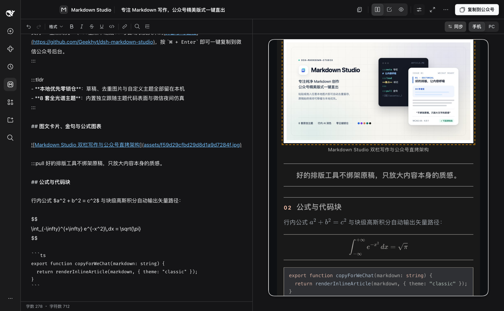

### Custom Writing Skills with inline red/green diff

Create or import standard `SKILL.md` Writing Skills from **More → Writing Skills** for your own house style, tightening, or headline polish (an open-source `Humanize` / `去 AI 味` preset is also included out of the box). Select any passage and press `⌘/Ctrl + J` or click the floating pill: edits stream from your configured host model into a word-level red/green inline diff (`Tab` to accept, `Esc` to reject) without affecting copied output until accepted.

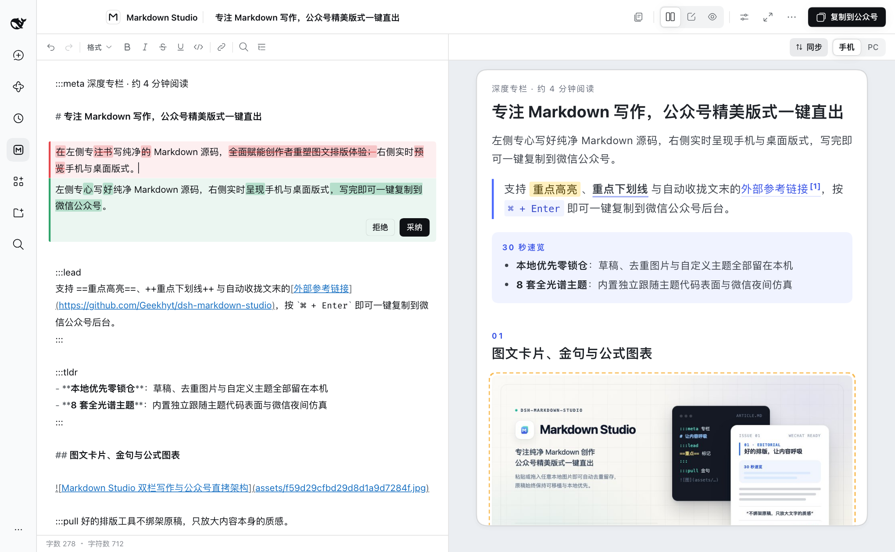

### Distraction-free immersive writing

Focus on long-form writing in full-screen Immersive Write or Immersive Preview mode with a minimal floating mode switcher and live word/character counts; press `Esc` anytime to return to the split workbench.

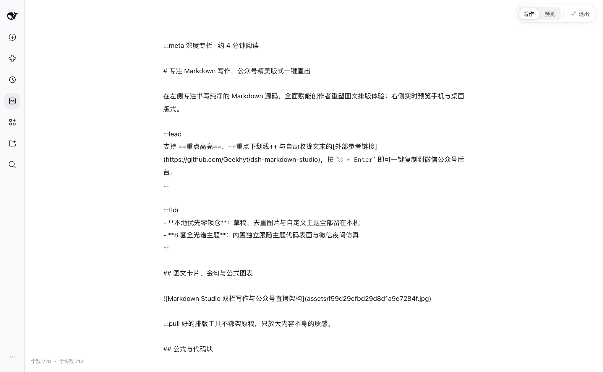

### Searchable article library and `.zip` archives

Manage multiple drafts and a recycle bin with keyword-highlighted title and excerpt search, conflict-aware merge import, full-library `.zip` backups with local images included, and two-way local `.md` folder sync.

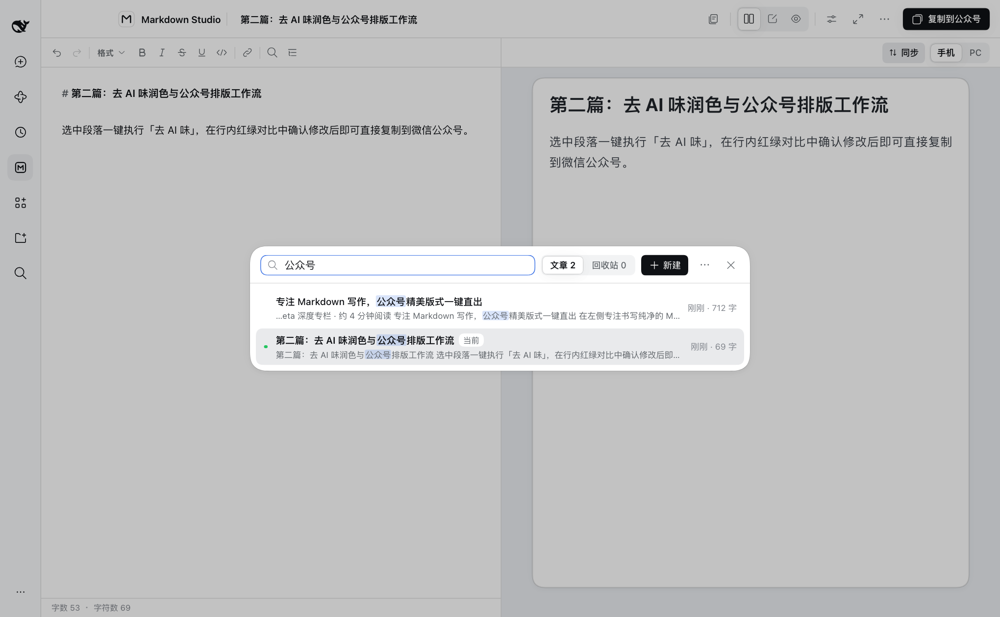

## Why `dsh-markdown-studio`

- **Zero host patches, fast startup**: Built on official DeepSeek Harness plugin APIs with a `2.1 KiB` gzipped core shell; the editor, math, and diagram engines load only when needed so everyday chats pay zero overhead.
- **What you preview is what pastes into WeChat**: Eight high-contrast editorial themes compile cleanly into self-contained inline styles, collect external links into bottom references, preserve code indentation, and keep dark preview isolated from light clipboard output.
- **100% local-first, your data stays yours**: Drafts, recycle bin entries, custom themes, and deduplicated local images remain on your machine. Unused images are cleaned up automatically on permanent deletion, linked files warn before overwriting external edits, and full `.zip` backups keep everything portable (see [storage and archive formats](./docs/schema.md)). *(Note: pasted local images are for local preview and draft archiving; upload local images to WeChat's media library or use public HTTPS URLs before publishing externally.)*

## Built-in themes and capabilities

| Category | Built-in capabilities | Details |
| :--- | :--- | :--- |
| **8 editorial themes** | `Classic`, `Gallery`, `Insight`, `Botanical`, `Noir Gold`, `Anthology`, `Briefing`, `Poster` | Full-spectrum presets spanning crisp blue, museum stone, violet explainer, warm oat stationery, obsidian gold, celadon bookleaf, crimson executive brief, and bold yellow poster, plus named custom CSS themes |
| **Code highlighting** | `Follow theme` (8 custom per-theme surfaces) + `GitHub Light/Dark`, `One Dark`, `Dracula`, `Nord`, `Solarized Light/Dark`, `Monokai` | Code blocks adapt live to each theme or switch to dedicated editor palettes, with full custom CSS override support |
| **Extended syntax** | `:::lead`, `:::tldr`, `:::pull`, `:::meta`, `:::sign`, auto figure captions, GFM tables, task lists, footnotes, `==highlight==`, `++underline++`, 5 callout types, `:::scroll` / `:::scroll-x`, TeX math, Mermaid | One-click insertion via the Format menu, `/` slash palette, and shortcuts (**Settings → Help** reference), with full English and Chinese UI & sample articles; raw HTML is escaped by default and diagrams render in an isolated sandbox |
| **Custom Writing Skills** | Create, import, and export standard `SKILL.md` skills (ships with open-source `Humanize` / `去 AI 味` preset) | Selection-triggered floating pill (`⌘/Ctrl + J`), word-level red/green inline diff, and Markdown syntax preservation guards |
| **Import and export** | One-click WeChat rich HTML / plain text copy, `.md`, standalone `.html`, single-article `.zip`, full-library `.zip` archive, local folder sync | Automatically adapts file export across desktop and browser environments with conflict-aware merge and bundled local assets |

## Documentation and license

- [Developer and architecture guide (English)](./docs/DEVELOPMENT.md) | [开发与架构文档（简体中文）](./docs/DEVELOPMENT.zh-CN.md) | [Interactive Theme Gallery](./docs/theme-gallery.html)
- [Reference docs index (Chinese)](./docs/README.md) | [Contributing guide](./CONTRIBUTING.md) | [Code of conduct](./CODE_OF_CONDUCT.md) | [Security policy](./SECURITY.md) | [Changelog](./CHANGELOG.md)
- Released under the [MIT License](./LICENSE). See [THIRD_PARTY_NOTICES.md](./THIRD_PARTY_NOTICES.md) and [THIRD_PARTY_LICENSES.txt](./THIRD_PARTY_LICENSES.txt) for third-party open-source notices.
