# dsh-markdown-studio

**简体中文** | [English](./README.en.md) | [开发与架构文档](./docs/DEVELOPMENT.zh-CN.md)

[](https://github.com/Geekhyt/dsh-markdown-studio/actions/workflows/ci.yml) [](https://www.npmjs.com/package/dsh-markdown-studio) [](./LICENSE) [](./package.json)

**专注 Markdown 写作，公众号精美版式一键直出。**

`dsh-markdown-studio`（Markdown Studio）是运行在 DeepSeek Harness 中的本地优先写作与微信公众号排版工作台。左侧专注纯净 Markdown 创作，右侧实时预览手机与桌面版式；内置 8 套全光谱原创排版主题、独立自定义 CSS 工作台与可自定义的写作 Skill 行内对比润色，一键复制即可直接粘贴到微信公众号后台。文章、图片与自定义主题全部留在本机——**不登录、零遥测、零云端锁仓**（仅在主动触发写作 Skill 时通过宿主已配置的模型处理所选片段）。

## 快速开始

**方式一：客户端界面一键安装（推荐，免终端与重启）**

打开 DeepSeek Harness 左侧边栏的 **插件** 页面，点击 **添加插件**，输入 `dsh-markdown-studio` 并选择 **立即启用**，即可在左侧边栏打开 **Markdown Studio**。

**方式二：命令行安装**

```bash
dsh plugin --profile desktop add dsh-markdown-studio
```

如果是从源码仓库本地体验，克隆后运行 `npm ci && npm run build`，再执行 `dsh plugin --profile desktop add link:.` 即可。后续升级版本执行 `dsh plugin --profile desktop add dsh-markdown-studio@latest`，卸载可执行 `dsh plugin --profile desktop remove dsh-markdown-studio`。

<details>
<summary><strong>点击展开 5 个可直接复制试跑的高阶语法与自定义主题片段</strong></summary>

1. **公众号原生编辑构件（开篇导语 / 速览卡 / 金句 / 眉题 / 落款）与提示块**：
   ```markdown
   :::meta 深度专栏 · 约 5 分钟阅读

   :::lead
   支持 ==荧光重点标记==、++重点下划线++ 与自动收拢文末的[外部参考链接](https://github.com/Geekhyt/dsh-markdown-studio)。
   :::

   :::tldr
   - 一行结论速览，自动渲染为跟随当前主题语言的要点卡片
   :::

   :::pull 好的排版工具不绑架原稿，只放大内容本身的质感。

   > [!TIP] 排版提示
   > 连续书写的 `[!NOTE]`、`[!TIP]`、`[!IMPORTANT]`、`[!WARNING]`、`[!CAUTION]` 会自动编译为独立色卡。

   :::sign 2026 · Markdown Studio 编辑部
   ```
2. **公众号内可滑动长图与横向多图画廊（`:::scroll` / `:::scroll-x`）**：
   ```markdown
   :::scroll 260
   这里可以放入长参数表、更新日志或长代码片段，在公众号阅读时保持定高纵向滑动。
   :::

   :::scroll-x
   
   
   :::
   ```
3. **自包含矢量公式（粘贴至公众号不丢字形）**：
   ```markdown
   行内公式 $E = mc^2$ 与块级高斯积分：

   $$
   \int_{-\infty}^{+\infty} e^{-x^2}\,dx = \sqrt{\pi}
   $$
   ```
4. **自动跟随主题配色的 Mermaid 流程图**：
   ````markdown
   ```mermaid
   flowchart LR
     MD["纯净 Markdown"] --> COMP["主题排版编译"] --> MP["微信公众号富文本"]
   ```
   ````
5. **新建专属命名自定义 CSS 主题（点击右侧「主题 → + 新建主题」，在左侧 CSS 工作台粘贴并保存）**：
   ```css
   .mdstudio-content {
     --mdstudio-accent: #0d9488;
     --mdstudio-bg: #f4fbfa;
     --mdstudio-quote-bg: #e6f7f5;
   }
   .mdstudio-content h2 {
     border-bottom: 2px solid #0d9488;
     padding-bottom: 6px;
   }
   ```

</details>

## 场景预览

### 分栏写作与实时版式预览

左侧专注纯净 Markdown 语法，支持 `/` 斜杠命令面板、参考 Notion 习惯的无冲突快捷键（如 `⌘/Ctrl + Shift + E` 行内公式、`⌘/Ctrl + Alt + 4` 任务清单、`⌘/Ctrl + Alt + -` 分割线，完整速查见右侧「设置 → 帮助」）、大纲跳转与查找替换；右侧在手机卡片与桌面全宽之间即时切换并支持双向滚动同步，按 `⌘/Ctrl + Enter` 一键复制到公众号。

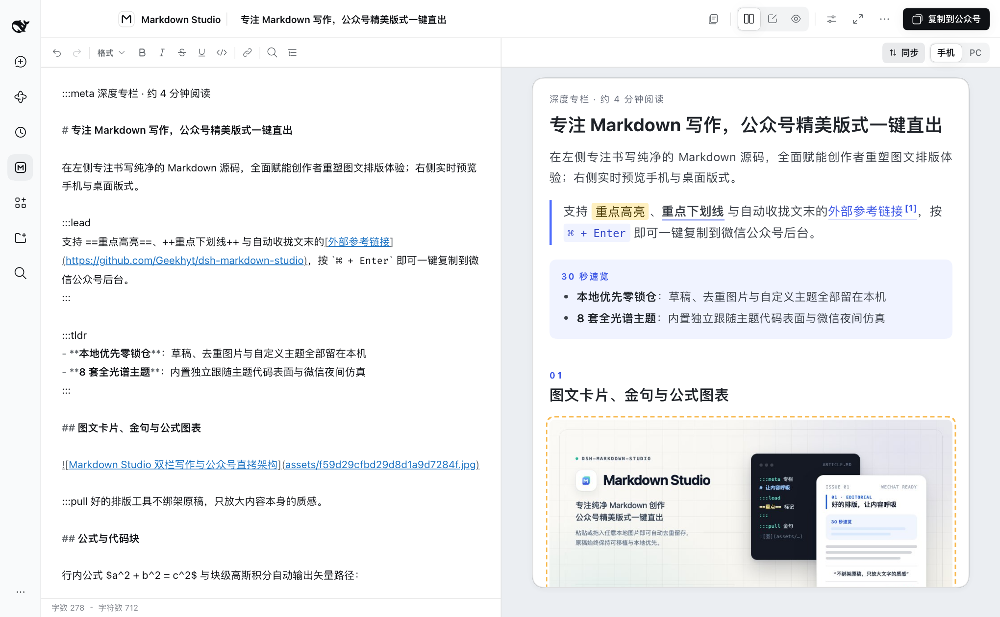

### 8 套全光谱内置主题与独立自定义 CSS 工作台

右侧设置抽屉内置 **经典、画廊、新知、森系、黑金、文集、简报、海报** 8 套原创主题及 8 套独立代码块配色；点击 **+ 新建主题** 可在左侧打开独立 CSS 工作台边改边看，保存后自动提取色彩缩略卡加入主题预设网格（也可下载 [8 套主题交互式预览画廊](./docs/theme-gallery.html) 后在本地浏览器打开，免安装体验）。

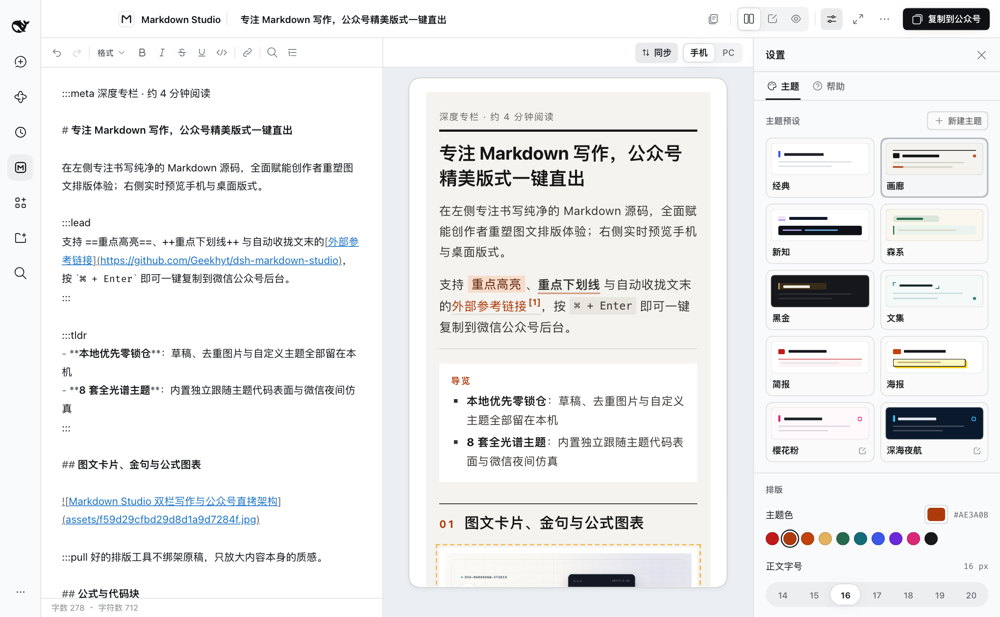

#### 8 套内置主题手机端公众号真机效果

同一篇纯 Markdown 原稿在 8 套内置主题下的手机端阅读效果对比（导语、速览卡标题、章节编号与代码块表面均自动跟随主题切换）：

| 经典 · Classic | 画廊 · Gallery | 新知 · Insight | 森系 · Botanical |
| :---: | :---: | :---: | :---: |
| 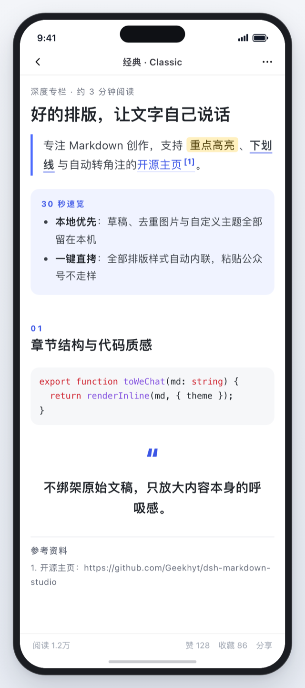 | 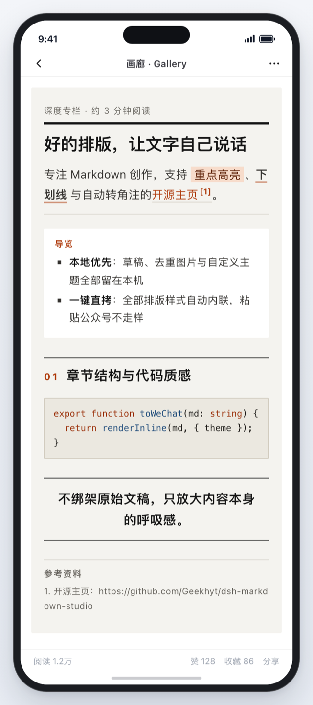 | 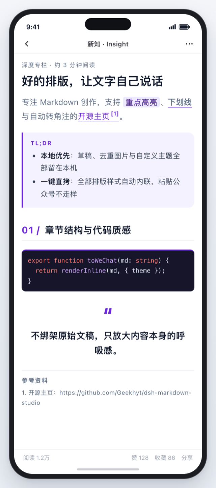 | 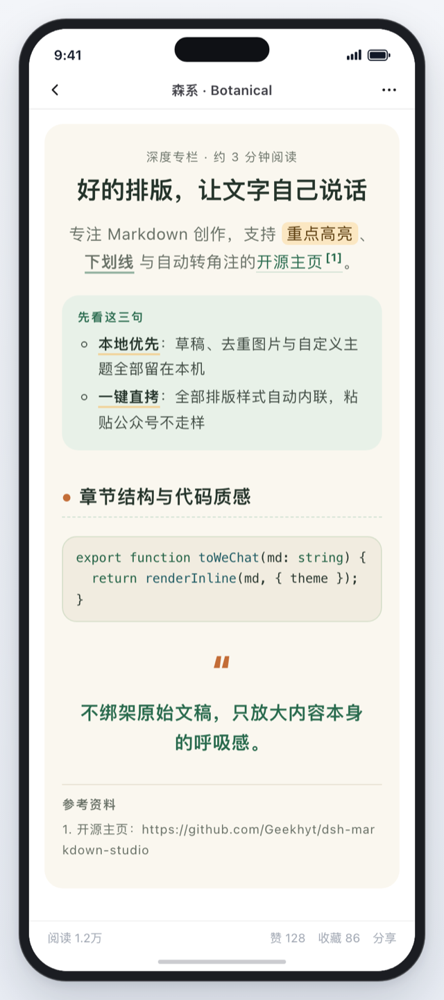 |
| 清爽白底蓝调 · `01` 上置编号 | 美术馆石纸 · 粗黑冠线与展签 | `01 /` 极光紫章题 · 深靛代码卡 | 燕麦暖信纸 · `●` 柿红虚线章题 |
| **黑金 · Noir Gold** | **文集 · Anthology** | **简报 · Briefing** | **海报 · Poster** |
| 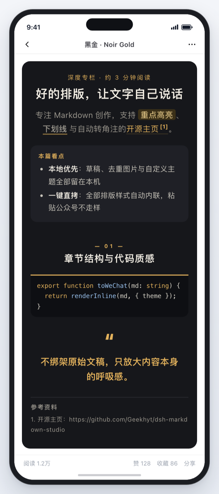 | 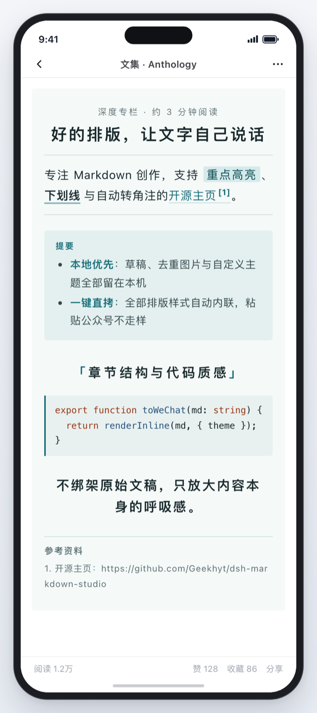 | 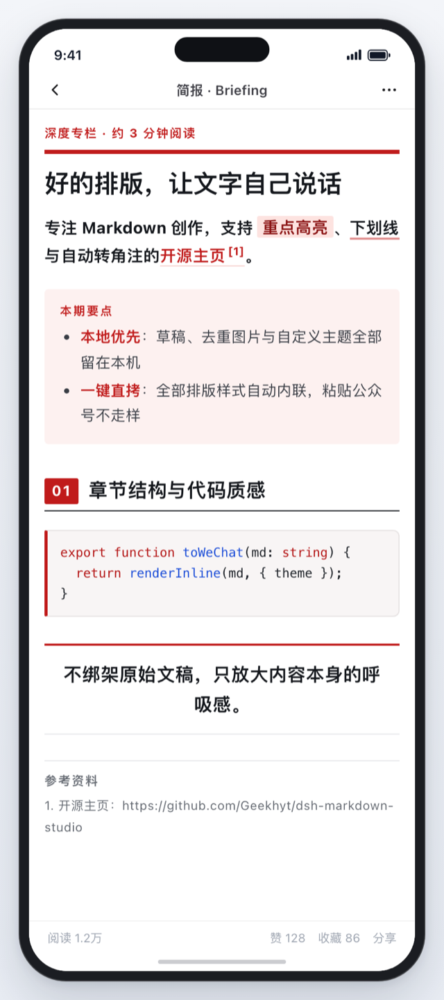 | 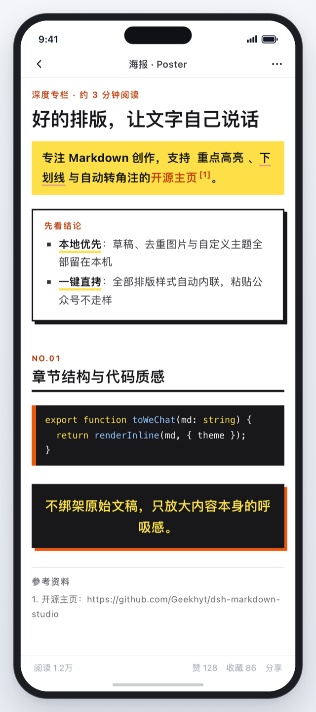 |
| 曜石暗底 · 香槟金居中片头章题 | 天青宋刻书页 · `「」` 括号章题 | 红顶线商业简报 · `[01]` 红底方章 | 明黄贴纸导语 · 硬阴影卡片 |

### 原生深色跟随与微信夜间阅读仿真

界面自动适配 DeepSeek Harness 浅色与深色主题。处于深色模式时，预览区自动模拟微信夜间阅读效果（含公式提亮与流程图适配），而复制到剪贴板的富文本始终保持干净的原始浅色排版。

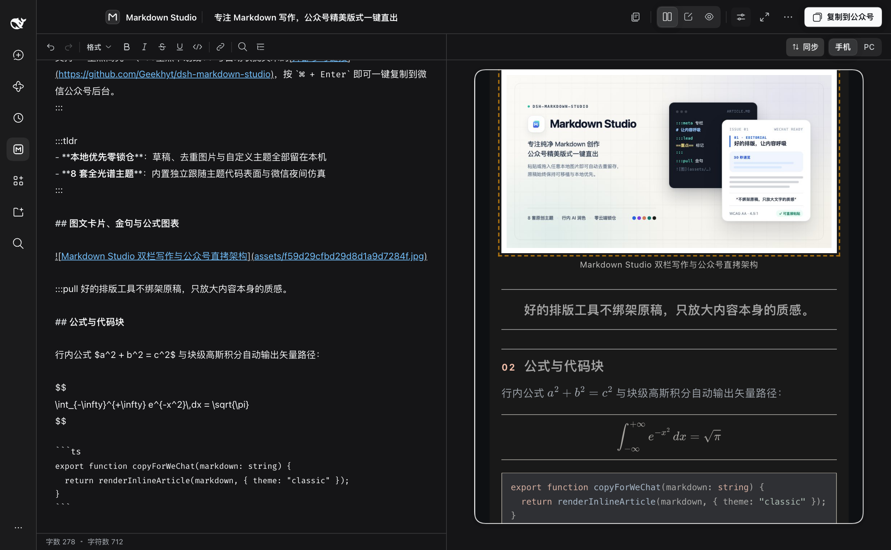

### 支持自定义写作 Skill 与行内对比润色

在「更多 → 写作 Skill 管理」可自由新建或导入标准 `SKILL.md` 自定义改写规则（如品牌文风统一、结构精简、标题打磨等，亦随包附带开源 `去 AI 味` 规则开箱即用）。选中任意段落按 `⌘/Ctrl + J` 或点击浮动胶囊，即可复用宿主已配置模型流式生成词级红绿行内对比，按 `Tab` 采纳、`Esc` 拒绝，未采纳前绝不影响复制成稿。

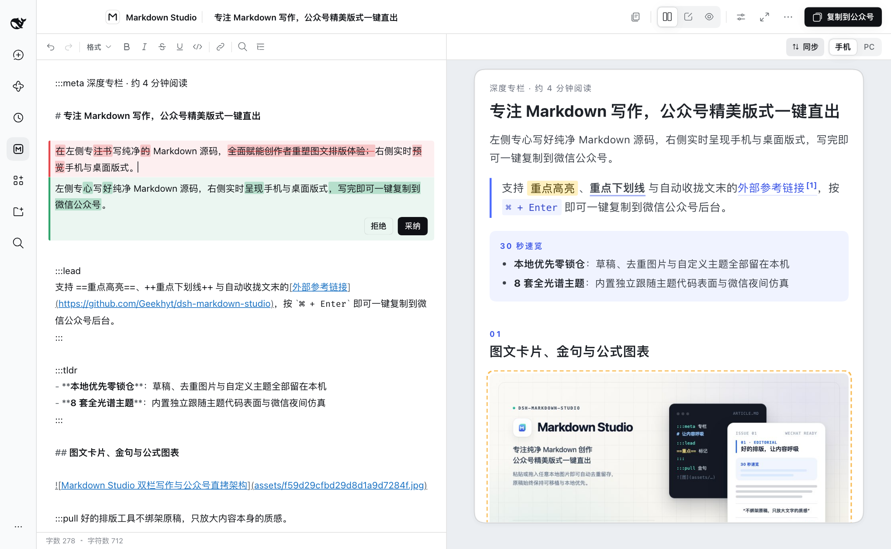

### 无干扰沉浸写作与实时字数角标

需要专注长文构思时，一键进入全屏沉浸写作或沉浸预览模式，右上角保留轻量切换胶囊，左下角实时统计字数与字符数，按 `Esc` 随时返回分栏工作台。

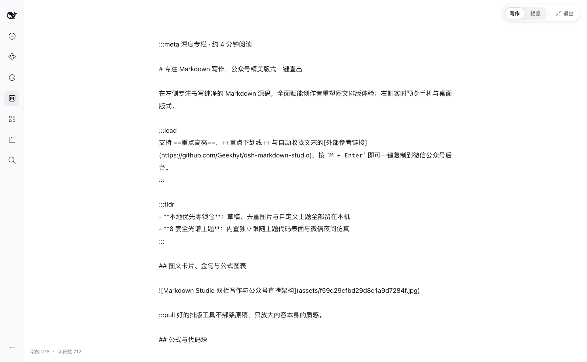

### 多文章库、全文高亮检索与 `.zip` 完整归档

内置多文章库与回收站，支持标题与正文双高亮搜索、冲突感知合并导入、含本地图片素材的 `.zip` 全量备份，以及本地 `.md` 文件夹双向同步。

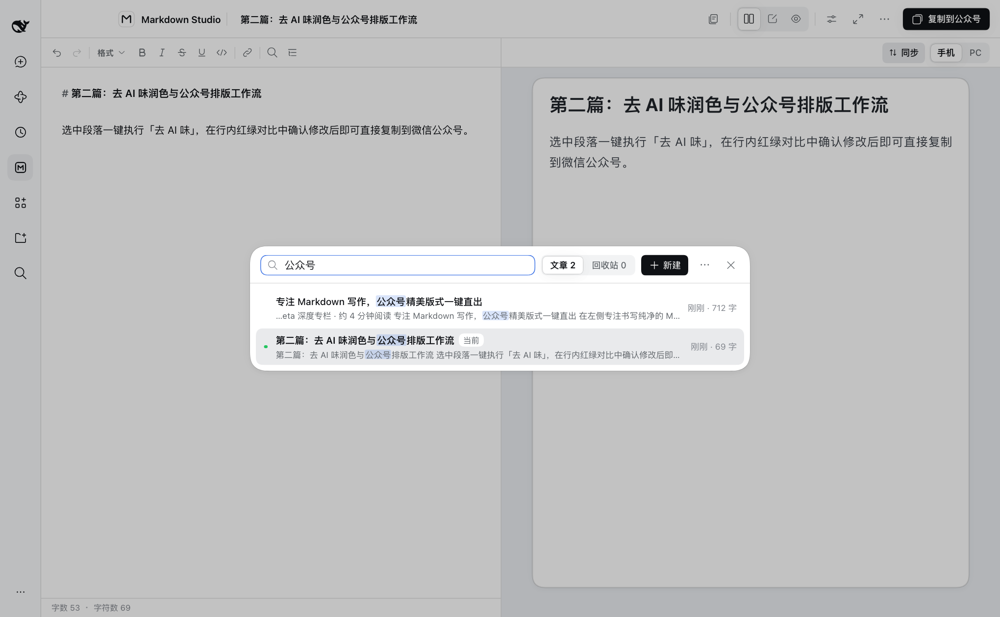

## 为什么选择 `dsh-markdown-studio`

- **官方接口实现，按需加载更轻快**：基于 DeepSeek Harness 官方插件接口构建，无任何宿主魔改；首屏核心包仅 `2.1 KiB`（gzip），编辑器、公式与流程图引擎仅在实际使用时按需加载，日常对话零负担。
- **所见即所得，粘贴公众号不走样**：8 套高对比度原创排版体系自动内联全部样式，外链自动收拢为文末参考资料，代码缩进完整保留，深色预览与浅色剪贴板严格隔离。
- **完全本地优先，数据主权归你**：草稿、回收站、自定义主题与自动去重的本地图片全部留在本机；彻底删除草稿时自动回收未引用图片，本地关联文件支持外部修改冲突提醒，并可随时导出完整 `.zip` 归档（详情见 [数据格式与容量](./docs/schema.md)）。*（注：粘贴的本地图片仅供本机预览与草稿归档；在微信公众号后台正式群发前，请上传替换至公众号素材库或使用公网图床链接。）*

## 内置主题与能力目录

| 维度 | 内置能力 | 说明 |
| :--- | :--- | :--- |
| **8 套内置主题** | `经典`、`画廊`、`新知`、`森系`、`黑金`、`文集`、`简报`、`海报` | 覆盖白底蓝调、石版画廊、极光科普、草木信笺、曜石流金、宋刻天青、红白简报与明黄海报全色域，支持多套命名自定义 CSS 主题 |
| **代码块高亮** | `跟随主题`（8 套独立主题定制表面）+ `GitHub Light/Dark`、`One Dark`、`Dracula`、`Nord`、`Solarized Light/Dark`、`Monokai` | 代码块配色跟随当前主题实时联动或自由切换独立配色，并支持自定义 CSS 覆盖 |
| **扩展语法** | `:::lead` 导语、`:::tldr` 速览卡、`:::pull` 金句、`:::meta` 眉题、`:::sign` 落款、单图自动图注、GFM 表格、任务清单、脚注、`==高亮==`、`++下划线++`、5 类提示块、`:::scroll` / `:::scroll-x`、TeX 公式、Mermaid | 顶栏「格式」菜单、`/` 斜杠面板与快捷键一键插入（右侧「设置 → 帮助」附完整说明），支持完整中英双语界面与示例文章；默认安全转义原始 HTML 并在隔离环境中渲染图表 |
| **自定义写作 Skill** | 支持新建与导入导出标准 `SKILL.md` 自定义规则（附带开源 `去 AI 味` 预设） | 选中即浮现、快捷键 `⌘/Ctrl + J` 触发、词级红绿行内对比与 Markdown 语法保护 |
| **导入与导出** | 一键复制公众号富文本 / 纯文本、`.md`、独立 `.html`、单篇 `.zip` 文章包、整库 `.zip` 归档、本地文件夹同步 | 自动适配桌面与浏览器文件导出，支持冲突感知合并与完整图片素材打包 |

## 文档与许可

- [开发与架构文档（简体中文）](./docs/DEVELOPMENT.zh-CN.md) | [Developer and architecture guide (English)](./docs/DEVELOPMENT.md) | [8 套主题静态画廊](./docs/theme-gallery.html)
- [专题文档索引](./docs/README.md) | [贡献指南](./CONTRIBUTING.md) | [行为准则](./CODE_OF_CONDUCT.md) | [安全策略](./SECURITY.md) | [更新日志](./CHANGELOG.md)
- 基于 [MIT License](./LICENSE) 开源，第三方开源依赖声明见 [THIRD_PARTY_NOTICES.md](./THIRD_PARTY_NOTICES.md) 与 [THIRD_PARTY_LICENSES.txt](./THIRD_PARTY_LICENSES.txt)。
