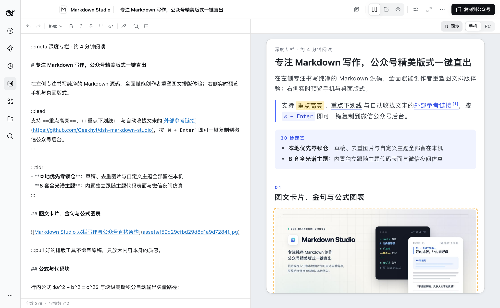

`dsh-markdown-studio` brings a local-first Markdown writing and WeChat Official Account typesetting studio directly into DeepSeek Harness. Write clean Markdown on the left, preview mobile and desktop layouts in real time on the right across 8 original themes or your own named CSS themes, polish selected passages with custom Writing Skills and inline red/green diff review, and copy ready-to-paste rich HTML for WeChat Official Accounts in one click. Every draft, image, and custom theme stays on your machine.

## Core capabilities

1. **Split-pane live preview and immersive mode**: Switch across Split, Edit, and Preview views, toggle Mobile and Desktop widths with bidirectional scroll sync, and use `/` slash commands, Notion-style shortcuts (**Settings → Help** cheat sheet), document outline jump, find & replace, full English/Chinese localization, and distraction-free immersive mode (`⌘/Ctrl + Shift + F` to enter, `Esc` to exit).
2. **One-click WeChat rich-HTML copy**: Press **Copy for WeChat** (`⌘/Ctrl + Enter`) to compile self-contained inline styles automatically, supporting editorial blocks (`:::lead`, `:::tldr`, `:::pull`, `:::meta`, `:::sign`) and `:::scroll` / `:::scroll-x` containers, automatic single-image captions, bottom link footnotes, and preserved code indentation.
3. **8 full-spectrum themes and Custom CSS Workbench**: Switch across 8 built-in themes or click **New theme** in the Theme presets drawer to open the left-pane CSS editor with live right-pane preview, automatically extracting color swatches into the **Theme presets** grid.
4. **Custom Writing Skills with inline red/green diff**: Create or import standard `SKILL.md` Writing Skills (with an open-source `Humanize` / `去 AI 味` preset included out of the box), streaming word-level red/green inline diffs from your configured host model (`Tab` to accept, `Esc` to reject).
5. **On-demand math & diagrams, searchable library, and folder sync**: Loads TeX math and Mermaid rendering engines only when needed; deduplicates pasted images locally and cleans up unused assets on permanent deletion; includes keyword-highlighted library search, recycle bin, conflict-aware merge, full `.zip` archives, and two-way local `.md` folder sync.

## Built-in 8 full-spectrum editorial themes

| Theme | Palette & typographic signature | Best for |
| :--- | :--- | :--- |
| **Classic** | Crisp blue accent, `01` overline section badges, soft blue-slate code cards | Engineering posts, release notes, general essays |
| **Gallery** | Museum stone paper, bold top crown rule, hairline `01` chapters, stone-framed code | Business insights, minimalist essays, design & product criticism |
| **Insight** | `01 /` violet numbered sections, violet-bar TL;DR cards, deep-indigo code blocks | AI deep dives, technical tutorials, research explainers |
| **Botanical** | Warm oat stationery, `●` persimmon dotted rules, honey marker highlights, sage code notes | Book notes, personal essays, podcast show notes |
| **Noir Gold** | Obsidian dark canvas, centered champagne-gold chapter rules, warm gold-tinted code | Annual reviews, flagship launches, showcase editions |
| **Anthology** | Celadon bookleaf tint, `「」` bracketed chapters, hairline quotes, three-line tables | Cultural criticism, humanities, curated anthologies |
| **Briefing** | Crimson top-rule executive brief, `[01]` square seals, red-header data tables | Weekly digests, market briefings, industry roundups |
| **Poster** | `NO.01` heavy black rules, vivid yellow sticker highlights, hard-offset shadow cards | Event announcements, curated rankings, bold dispatches |

- **Independent code palettes**: Choose **Follow theme** or 8 dedicated palettes (`GitHub Light`, `GitHub Dark`, `One Dark`, `Dracula`, `Nord`, `Solarized Light`, `Solarized Dark`, `Monokai`).
- **Repository and full documentation**: [github.com/Geekhyt/dsh-markdown-studio](https://github.com/Geekhyt/dsh-markdown-studio)
