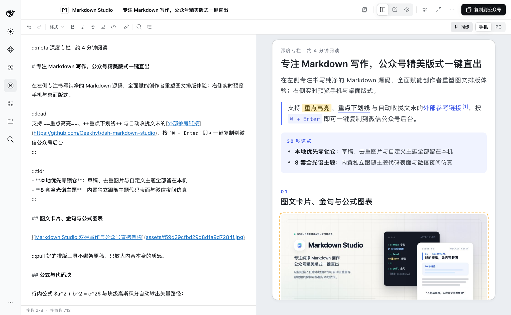

`dsh-markdown-studio` 在 DeepSeek Harness 中提供本地优先的 Markdown 写作与微信公众号排版工作台。左侧专注纯净 Markdown 创作，右侧实时预览手机与桌面版式；内置 8 套原创主题、独立自定义 CSS 工作台与可自定义的写作 Skill 行内对比润色，一键复制即可直接粘贴到微信公众号后台。所有草稿、图片与自定义主题均留在本机。

## 核心创作体验

1. **分栏实时预览与无干扰沉浸模式**：支持分栏、纯编辑、纯预览三视图，手机卡片与桌面宽度一键切换，内置双向滚动同步、`/` 斜杠快捷指令、参考 Notion 习惯的无冲突快捷键（右侧「设置 → 帮助」附完整速查）、文章大纲定位、查找替换、完整中英双语界面与沉浸写作（`⌘/Ctrl + Shift + F` 进入，`Esc` 退出）。
2. **微信公众号富文本一键直拷**：点击右上角 **复制到公众号**（或按 `⌘/Ctrl + Enter`）即可自动内联全部排版样式，原生支持 `:::lead` 开篇导语、`:::tldr` 速览卡、`:::pull` 金句、`:::meta` 眉题、`:::sign` 文末落款及 `:::scroll` / `:::scroll-x` 滑动容器，单图自动生成图注，外链自动收进文末参考资料并完整保留代码缩进。
3. **8 套全光谱主题与独立左栏自定义 CSS 工作台**：除 8 套内置主题外，可在右侧「主题 → + 新建主题」打开左侧自定义 CSS 工作台边改边看，保存后自动提取色彩缩略卡加入主题预设网格。
4. **支持自定义写作 Skill 与行内对比润色**：支持新建或导入标准 `SKILL.md` 自定义写作 Skill（附带开源 `去 AI 味` 预设），选中段落即可复用宿主已配置模型流式生成红绿行内对比，支持 `Tab` 采纳与 `Esc` 拒绝。
5. **按需公式图表、文章库与本地同步**：仅在文章包含 TeX 公式或 Mermaid 图表时按需加载渲染引擎；粘贴图片自动去重存至本机并在彻底删除草稿时清理未引用素材；内置全文高亮搜索、回收站、冲突感知合并、`.zip` 完整归档与本地 `.md` 文件夹双向同步。

## 内置 8 套全光谱主题体系

| 主题名称 | 色调与版式特征 | 适用场景 |
| :--- | :--- | :--- |
| **经典** | 清爽白底蓝调、`01` 上置小号编号章题与蓝灰圆角代码卡 | 日常技术推文、产品更新说明 |
| **画廊** | 美术馆石纸画布、顶粗黑冠线标题、细黑顶线章题与石框展签 | 商业洞察、极简主义随笔、建筑与产品评论 |
| **新知** | `01 /` 极光紫序号章题、紫边速览卡与深靛蓝代码块 | AI 前沿解读、科普长文、教程指南 |
| **森系** | 燕麦信笺暖底、`●` 柿红圆点虚线章题、蜂蜜手划线重点与鼠尾草便签 | 读书笔记、生活随笔、播客文稿 |
| **黑金** | 曜石暗底、香槟金居中片头章题与暗金柔光代码台 | 年度盘点、旗舰发布、高质感特辑 |
| **文集** | 天青宋刻书页、「」括号章题、留白引文与学术三线表 | 文化评论、古籍漫谈、散文集 |
| **简报** | 红顶线商业简报、`[01]` 红底方章、红头数据表与研报代码卡 | 行业周报、商业拆解、热点速递 |
| **海报** | `NO.01` 粗黑底线章题、明黄贴纸高亮、硬阴影卡片与撕线分割 | 活动预告、榜单盘点、先锋快讯 |

- **独立代码块高亮**：除跟随文章主题外，内置 `GitHub Light`、`GitHub Dark`、`One Dark`、`Dracula`、`Nord`、`Solarized Light`、`Solarized Dark`、`Monokai` 8 套代码配色。
- **本地图片说明**：本机粘贴的图片仅供本地预览与草稿归档；在微信公众号后台正式群发前，请将本地图片上传替换至公众号素材库或使用公网图床链接。
- **项目主页与完整文档**：[github.com/Geekhyt/dsh-markdown-studio](https://github.com/Geekhyt/dsh-markdown-studio)
