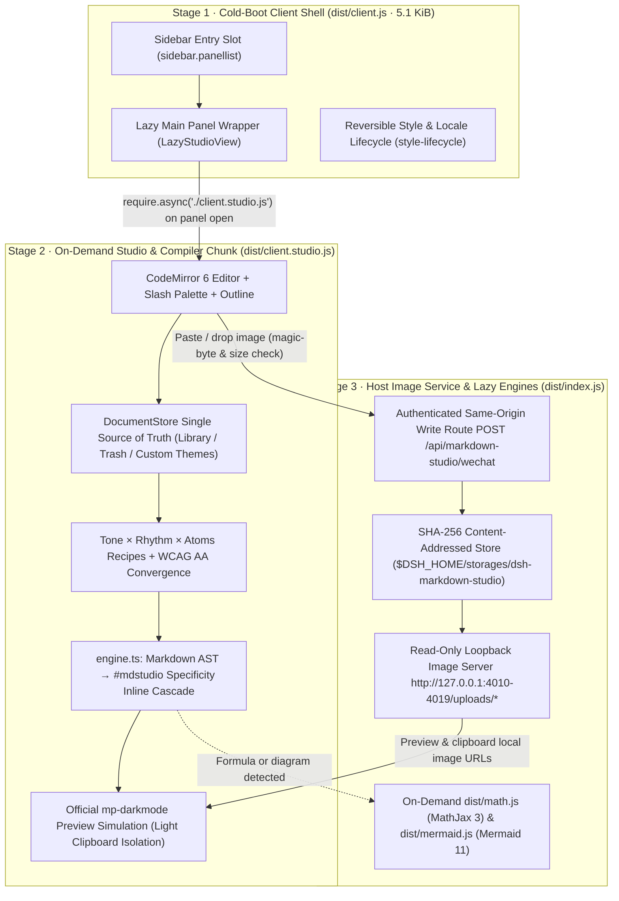

# Developer & Technical Architecture Guide (`dsh-markdown-studio`)

**English** | [简体中文](./DEVELOPMENT.zh-CN.md) | [Back to Product README](../README.en.md)

This guide is written for plugin contributors, architecture reviewers, and maintainers. It covers the three-tier runtime architecture of `dsh-markdown-studio`, zero-hack **DeepSeek Harness (DSH)** extension seam mapping, five-bundle lazy-loading budgets, the `Tone × Rhythm × Atoms` theme and inline-CSS compiler, the content-addressed local image security model, and local verification gates.

---

## 1. End-to-End Runtime Architecture

`dsh-markdown-studio` cleanly separates into a **cold-boot client shell**, an **on-demand Studio runtime chunk**, and a **self-contained Node.js / Cordis Host image & chunk service**:

1. **Ultra-Light Cold-Boot Shell (`dist/client.js`, `5.1 KiB`)** — On DSH startup, only a minimal entry loads to register the left-sidebar icon (`sidebar.panellist`), base locale labels, and a lazy `main` view container. Normal AI chat sessions pay **zero editor parse or execution cost**.
2. **On-Demand Studio & Cascade Compiler (`dist/client.studio.js`)** — Clicking **Markdown Studio** triggers DSH's official `require.async("./client.studio.js")` loader, bringing in CodeMirror 6, `DocumentStore`, the `Tone × Rhythm × Atoms` recipe engine, and the deterministic `#mdstudio` inline-CSS compiler.
3. **On-Demand Heavy Renderers (`dist/math.js` & `dist/mermaid.js`)** — Loaded only when an article contains TeX math (`$...$` / `$$...$$` or `\(...\)` / `\[...\]`) or ```` ```mermaid ```` fences, producing self-contained vector `<path>` SVGs (MathJax 3) and `strict`-sandbox rasterized diagrams (Mermaid 11 + `DOMPurify`).
4. **Dual-Channel Local Image Host & Loopback AI Route (`dist/index.js`)** — Image writes go through the host-authenticated, same-origin `POST /api/markdown-studio/wechat` endpoint (deduplicated by SHA-256 on disk) while previews read from a `127.0.0.1`-bound read-only server; selection-triggered AI Writing Skills stream over same-origin `POST /api/markdown-studio/ai` via the host's configured `llm` service.



---

## 2. Five Core Engineering Principles

1. **100% Local-First, Zero Cloud Lock-In** — No accounts, no telemetry, and no remote image uploads. Markdown source files store portable relative paths (`assets/<24-hex>.(png|jpg)`) and export cleanly to `.md`, standalone `.html`, or streaming `.zip` archives.
2. **Unidirectional Clean Architecture & Effect-Free Business Layer** — Strict `ui → application → domain` dependency flow with `adapters` implementing platform seams and `src/runtime/` isolating low-level React lifecycle & DOM primitives. `domain`, `theme-system`, and `engine.ts` (`markdown-parser.ts` + `css-inliner.ts`) have zero React or browser-global dependencies, and `useEffect` / `useLayoutEffect` are banned everywhere outside `src/runtime/` — enforced automatically by `test/architecture.test.ts`.
3. **Deterministic Specificity Inline Compiler** — Because WeChat strips `<style>` blocks and CSS custom properties on paste, `engine.ts` resolves `var(--mdstudio-*)` tokens and selector specificity locally into `<section id="mdstudio">` inline styles with zero unresolved variables, zero `!important`, and zero `font-family` leakage.
4. **Mathematical Contrast Convergence & Dark-Mode Isolation** — Every built-in palette converges body copy to at least WCAG 2 AA (`4.5:1`) contrast. Under host dark mode, the preview runs WeChat's `mp-darkmode` transform and lifts dark vector equations while keeping copied clipboard HTML strictly in the authored light palette.
5. **Host-Native Experience & Reversible Unload** — Built on `@deepseek-ai/dsh-client-ui-primitives` and `--dsw-*` design tokens. Disabling the plugin in DSH Plugin Manager detaches all `<style data-plugin="dsh-markdown-studio">` nodes and locale registrations cleanly; hot re-enabling restores them without reloading the window.

---

## 3. Zero-Hack DeepSeek Harness Extension Mapping

`dsh-markdown-studio` relies exclusively on documented DSH plugin contracts:

| Layer | Official DSH Extension Seam | Role in `dsh-markdown-studio` |
| :--- | :--- | :--- |
| **Client UI Slots** | `sidebar.panellist`, `main` | Mounts the sidebar panel icon and the main Markdown Studio workspace. |
| **Locale Service** | `locale.register`, `locale.bind`, `locale/*.json` | Synchronizes UI chrome (`zh` / `en`) and serves localized Plugin Manager detail pages via `meta.detail`. |
| **Shared UI Primitives** | `@deepseek-ai/dsh-client-ui-primitives` | Reuses native `Button`, `SegmentedTabs`, `Modal`, `Menu`, `Tooltip`, `Input`, and `--dsw-*` tokens. |
| **Client Chunk Loader** | `window.__ModuleLoader__.load` + `require.async` | Keeps cold-boot `dist/client.js` at `5.1 KiB` and loads the studio runtime on demand. |
| **Host Web & LLM Services** | Cordis `webServer.register`, optional `llm` / `agentDefaultModel` | Registers authenticated image actions, loopback AI Writing Skill streaming, and lazy MathJax / Mermaid chunk routes. |

### Five-Bundle Lazy-Loading Size Breakdown

| Artifact | Raw Size | Gzip Size | Hard Budget Gate | Responsibility & Load Trigger |
| :--- | :--- | :--- | :--- | :--- |
| `dist/client.js` | **`5.1 KiB`** | **`2.3 KiB`** | `<= 50 KiB` | Cold-boot shell: registers sidebar entry, base locale, and lazy container. |
| `dist/client.studio.js` | `1270.4 KiB` | `397.2 KiB` | `<= 1280 KiB` | Loaded on demand when opening Markdown Studio (CodeMirror 6, 8 themes, inline AI diff, `mp-darkmode`). |
| `dist/index.js` | `111.8 KiB` | `55.6 KiB` | `<= 150 KiB` | Self-contained Host ESM bundle (SHA-256 image store + loopback server + AI route), zero runtime npm deps. |
| `dist/math.js` | `1764.9 KiB` | `594.5 KiB` | `<= 2048 KiB` | Loaded on demand when TeX math appears (MathJax 3 vector `<path>` SVGs). |
| `dist/mermaid.js` | `3418.2 KiB` | `957.2 KiB` | `<= 4096 KiB` | Loaded on demand when `mermaid` code fences appear (Mermaid 11 `strict` + `DOMPurify`). |

---

## 4. Theme Recipe System & Security Thresholds

### `Tone × Rhythm × Atoms` Composable Theme Engine
- **Tone**: Derives background, surface, quote, border, and per-theme code colors from a seed accent with automatic WCAG 2 AA contrast convergence (`>= 4.5:1` body and code text).
- **Rhythm**: Controls body font size (`14px–20px`), line height (`1.40–2.40`, `1.75` standard editorial default), heading proximity (`1.65em / 0.65em` H2, `0.75em` consecutive headings), paragraph spacing, and letter spacing.
- **Atoms**: Composes section heading ornaments (`01` overline, hairline `01` top rule, `01 /` violet index, `●` dotted rule, centered champagne-gold rule, `「」` bookleaf brackets, `[01]` square seal, `NO.01` poster underline), editorial blocks (`:::lead`, `:::tldr`, `:::pull`, `:::meta`, `:::sign`), standalone figure captions, blockquotes, tables, five GitHub Alert types, and footnotes.
- **Named Custom CSS Themes**: Users can author multiple named CSS themes (optionally declaring `/* @base: standalone | classic */`) that automatically extract color swatches into the **Theme Presets** grid, share across articles, and export/import as JSON.

### Security Model & Hard Limits
- **Raw HTML & Protocol Filtering**: Escapes raw inline HTML (`<script>`, ``) by default and blocks `javascript:`, `vbscript:`, and `data:text/html` URIs (schemes are checked after stripping whitespace/control characters); TeX never loads MathJax's `html` extension (`\href`, `\style`).
- **Dual-Channel Local Image & Loopback AI Isolation**: Image write requests enforce loopback client IP (`127.0.0.1` / `::1`), an exact `application/json` MIME type, and origin checks (http(s) `Origin` must match `Host`; missing origins and trusted desktop schemes `dsh-app:`, `dsh:`, `app:`, `file:` pass; `null` passes only with `Sec-Fetch-Site: same-origin/none`), PNG/JPEG magic-byte inspection, and a `1 MB` per-image cap; the loopback preview server binds exclusively to `127.0.0.1`, accepts only `GET / HEAD / OPTIONS`, and matches `^[a-f0-9]{24}\.(png|jpg)$` with `X-Content-Type-Options: nosniff`. The selection-triggered AI route (`POST /api/markdown-studio/ai`) applies the same loopback, origin, and MIME checks with a `512 KiB` body cap, rejects interrupted or length-truncated model output, forwarding only user-selected snippets to the host `llm` service.
- **External CSS Resource Stripping**: External `url(...)`, `image-set(...)`, `src(...)`, `cross-fade(...)`, and `@import` rules inside custom CSS (including comment-split, newline-escaped, CSS-escaped, and post-`var()` resolved variants) are stripped by default to prevent outbound tracking beacons.

---

## 5. Local Development & Verification Gates

Requires Node.js LTS (`^22.18.0 || >=24.11.0`):

```bash
# 1. Install dependencies from lockfile
npm ci

# 2. Lint, typecheck, build all 5 bundles, verify third-party licenses, and run all 31 unit/integration test suites
npm run lint
npm run typecheck
npm run build
npm run licenses:check
npm test

# 3. Coverage gate + CRAP <= 30 across all core functions + bundle size budgets
npx playwright install chromium
npm run quality

# 4. Mutation smoke gate & local DSH app.asar API drift check
npm run mutation
npm run check:host-api

# 5. Headless Chromium smoke + axe-core WCAG 2 AA scan + visual baseline
npm run test:browser

# 6. Link into DeepSeek Harness Desktop for live local testing
dsh plugin --profile desktop add link:.
```

---

## 6. Deep-Dive Reference Docs

- [Theme & Custom CSS Contract (zh-CN)](./theme-css.md) — `--mdstudio-*` custom properties and supported selectors
- [WeChat Rich-HTML Specification (zh-CN)](./wechat-html.md) — Official Account paste structure, math, and list constraints
- [Persistence & Archive Schema (zh-CN)](./schema.md) — `localStorage`, JSON backup, and streaming `.zip` versioning
- [Local Loopback Image Server Protocol (zh-CN)](./image-server.md) — Dual-channel HTTP routes and error codes
- [Layered Architecture Details (zh-CN)](./architecture.md) | [Domain Glossary (zh-CN)](./glossary.md) | [Design References (zh-CN)](./design-references.md) | [Interactive 8-Theme Preview Gallery](./theme-gallery.html)
