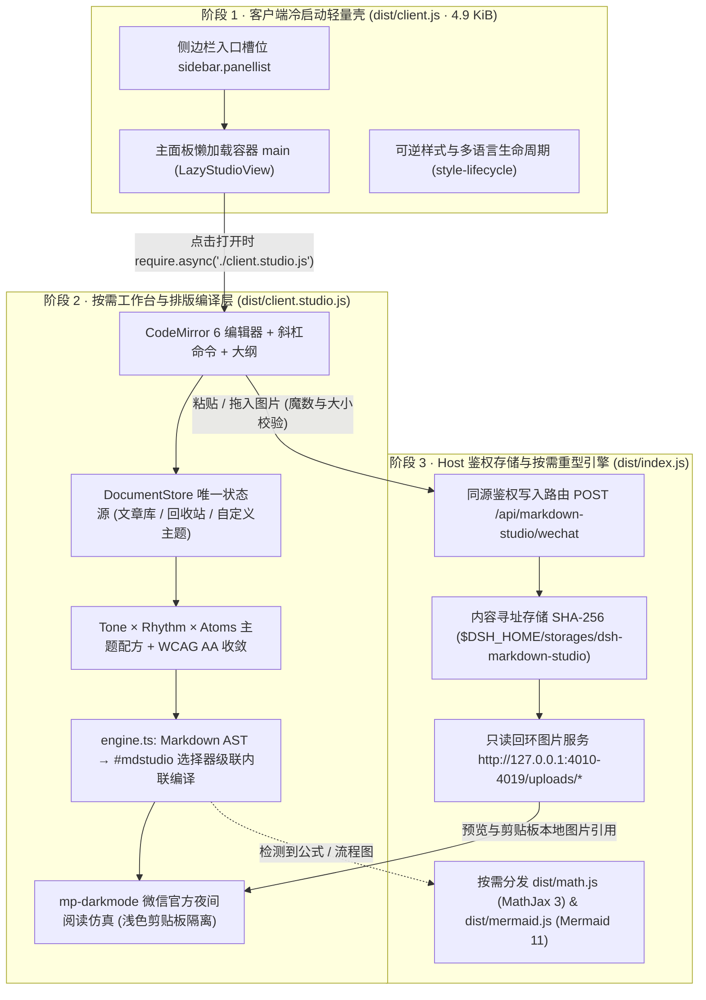

# 开发与技术架构文档（`dsh-markdown-studio`）

[English](./DEVELOPMENT.md) | **简体中文** | [返回产品主页 README](../README.md)

本文档面向插件开发者、架构评审者与社区贡献者，详细介绍 `dsh-markdown-studio` 的分层运行架构、**DeepSeek Harness（DSH）** 零 Hack 官方扩展点映射、五产物按需懒加载体积预算、`Tone × Rhythm × Atoms` 主题与内联级联编译器、本机内容寻址图片安全模型，以及本地调试与质量门禁流程。

---

## 1. 整体分层与端到端运行架构

`dsh-markdown-studio` 严格解耦为 **客户端冷启动壳（Shell）**、**按需工作台运行时（Studio Chunk）** 与 **本机 Host 图片及按需分包服务（Node.js / Cordis）**：

1. **极简冷启动壳（`dist/client.js`，仅 `4.9 KiB`）** —— DSH 启动时仅加载极简入口，注册左侧边栏图标（`sidebar.panellist`）、基础多语言与主视图懒加载容器（`main`）。用户在日常 AI 对话期间**零编辑器脚本开销**。
2. **工作台与可逆排版流水线（`dist/client.studio.js`）** —— 当用户首次点击打开 **Markdown Studio** 时，通过 DSH 官方 `require.async("./client.studio.js")` 按需加载 CodeMirror 6、`DocumentStore`、`Tone × Rhythm × Atoms` 主题系统及内联样式级联编译器。
3. **重型渲染器按需加载（`dist/math.js` & `dist/mermaid.js`）** —— 仅当当前文稿包含 TeX 公式（`$...$` / `$$...$$` 与 `\(...\)` / `\[...\]`）或 ```` ```mermaid ```` 代码块时，才从本机 Host 拉取 MathJax 3（自包含矢量 `<path>` SVG）或 Mermaid 11（`strict` 沙箱 + `DOMPurify` 光栅化）。
4. **双通道隔离的本机图片服务与按需回环 AI 路由（`dist/index.js`）** —— 图片写入动作走受宿主鉴权的同源 `POST /api/markdown-studio/wechat`（SHA-256 去重落盘），预览走仅绑定 `127.0.0.1` 的只读回环服务；AI 写作 Skill 走同源回环 `POST /api/markdown-studio/ai`，仅在用户主动触发时调用宿主已配置的 `llm` 服务处理选中片段。



---

## 2. 五大核心工程设计原则

1. **100% 本地优先，零云端锁仓（Local-First, Zero Cloud）** —— 无账号、无遥测、无公网图床上传。Markdown 原文仅保存可移植相对路径 `assets/<24-hex>.(png|jpg)`，随时可导出为标准 `.md`、单文件 `.html` 或流式 `.zip` 完整归档。
2. **单向洁净分层与业务层零 `useEffect`（Clean Architecture & Effect-Free Business Layer）** —— 严格遵循 `ui → application → domain`，`adapters` 单向实现平台能力，底层生命周期与外部订阅统一收敛至 `src/runtime/`；`domain`、`theme-system` 与 `engine.ts`（`markdown-parser.ts` + `css-inliner.ts`）零 React、零 DOM 全局耦合，且业务层全面封禁 `useEffect` / `useLayoutEffect`，由 `test/architecture.test.ts` 自动守护。
3. **确定性级联内联编译（Deterministic Inline-CSS Cascade）** —— 微信公众号编辑器会剥离 `<style>` 标签与 CSS 变量。`engine.ts` 在本地完整解析选择器优先级（Specificity）与 `var(--mdstudio-*)` 自定义属性，编译出零变量残留、零 `!important`、零 `font-family` 污染的 `<section id="mdstudio">` 富文本。
4. **对比度数学收敛与浅色复制隔离（WCAG AA & Dark-Mode Isolation）** —— 所有内置主题自动收敛正文与背景至少 `4.5:1` 对比度；当宿主处于深色主题时，预览区运行 `mp-darkmode` 仿真并自动提亮暗色矢量公式，但点击「复制」写入系统剪贴板的富文本始终严格保持原始浅色排版。
5. **宿主原生融合与可逆卸载（Host-Native & Reversible Lifecycle）** —— 直接复用 `@deepseek-ai/dsh-client-ui-primitives` 原语与 `--dsw-*` 设计令牌；在插件管理器中热停用插件时自动卸载全部 `<style data-plugin="dsh-markdown-studio">` 与多语言句柄，热重启用即刻恢复。

---

## 3. 零 Hack 接入 DeepSeek Harness 官方扩展面

本插件 **100% 构建于 DSH 公开插件契约之上**，不抓取私有 Electron IPC、不注入全局样式污染宿主会话页：

| 架构分层 | 使用的 DSH 官方公开扩展接口 | 在 `dsh-markdown-studio` 中的职责 |
| :--- | :--- | :--- |
| **Client 槽位层** | `sidebar.panellist`、`main` | 注册左侧边栏矢量入口图标与主工作台视图。 |
| **多语言服务** | `locale.register`、`locale.bind`、`locale/*.json` | 跟随宿主中英语言切换界面文案，并通过 `meta.detail` 提供插件详情页。 |
| **共享 UI 原语** | `@deepseek-ai/dsh-client-ui-primitives` | 复用宿主原生 `Button`、`SegmentedTabs`、`Modal`、`Menu`、`Tooltip`、`Input` 与语义变量。 |
| **客户端按需分包** | `window.__ModuleLoader__.load` + `require.async` | 首屏仅加载 `4.8 KiB` 轻量壳，点击面板后再按需加载编辑器与排版运行时。 |
| **Host Web 与模型服务** | Cordis `webServer.register`、可选 `llm` / `agentDefaultModel` | 注册同源鉴权图片路由、按需 AI 写作流式路由与 MathJax / Mermaid 分包路由。 |

### 五分包按需懒加载体积明细

| 构建产物 | 原始体积 | Gzip 体积 | 体积预算门禁 | 职责与加载触发时机 |
| :--- | :--- | :--- | :--- | :--- |
| `dist/client.js` | **`4.9 KiB`** | **`2.3 KiB`** | `<= 50 KiB` | 首屏冷启动轻量壳：仅注册侧边栏图标、基础多语言与懒加载容器。 |
| `dist/client.studio.js` | `1257.8 KiB` | `393.1 KiB` | `<= 1280 KiB` | 仅在点击打开 Markdown Studio 时加载（含 CodeMirror 6、8 套主题、行内 AI Diff 与 `mp-darkmode`）。 |
| `dist/index.js` | `111.1 KiB` | `55.3 KiB` | `<= 150 KiB` | 自包含 Host ESM 服务（内容寻址图片管理 + 只读回环预览 + 同源 AI 路由），零运行时 npm 依赖。 |
| `dist/math.js` | `1762.1 KiB` | `593.3 KiB` | `<= 2048 KiB` | 仅当文稿出现 TeX 公式时按需加载 MathJax 3（自包含字体轮廓 `<path>` SVG）。 |
| `dist/mermaid.js` | `3413.6 KiB` | `955.5 KiB` | `<= 4096 KiB` | 仅当文稿出现 `mermaid` 代码块时按需加载 Mermaid 11（严格沙箱 + `DOMPurify`）。 |

---

## 4. 主题配方系统与安全边界阈值

### `Tone × Rhythm × Atoms` 三层主题架构
- **Tone（色调调色板）**：由主色自动派生背景、次级底色、引用底色、边框色与每套主题独立的跟随代码块表面，并经 WCAG 2 AA 对比度函数收敛（正文与代码文字均 `>= 4.5:1`）。
- **Rhythm（字号与节奏）**：控制正文字号（`14px–20px`）、行高（`1.40–2.40`，标准默认 `1.75`）、标题亲密性间距（`H2` `1.65em / 0.65em`、连续标题自动收紧至 `0.75em`）、段落呼吸感与字距。
- **Atoms（独立版式原子）**：章题装饰（上置小号 `01`、细黑顶线 `01`、`01 /` 极光紫序号、`●` 圆点虚线、香槟金居中线、「」宋刻括号、`[01]` 红底方章、`NO.01` 粗黑底线）、公众号编辑构件（`:::lead` 开篇导语、`:::tldr` 速览卡、`:::pull` 金句、`:::meta` 眉题、`:::sign` 落款）、单图自动图注、引用框、三线/红头数据表、五类 GitHub Alerts 与脚注样式。
- **多套命名自定义 CSS 主题**：用户可新增多套自定义 CSS 主题（支持 `/* @base: standalone | classic */` 显式声明是否继承 Classic 基底），实时提取背景色、文字色与主色生成预设缩略卡，跨文章自动共享并支持 JSON 导入导出。

### Host 与渲染安全边界
- **原始 HTML 与危险协议拦截**：默认转义 Markdown 中的原始 HTML（如 `<script>`、``），严格拦截 `javascript:`、`vbscript:`、`data:text/html` 协议（先剔除空白与控制字符再判断）；TeX 公式不加载 MathJax `html` 扩展（`\href`、`\style`）。
- **双通道图片与同源回环 AI 校验**：图片写入接口强制校验回环源 IP（`127.0.0.1` / `::1`）、`application/json` 主类型与来源（http(s) `Origin` 必须与 `Host` 一致；缺失 Origin 与受信任桌面端 scheme `dsh-app:` / `dsh:` / `app:` / `file:` 放行，`null` 仅在 `Sec-Fetch-Site: same-origin/none` 时放行）、PNG/JPEG 文件头魔数及单图 `1 MB` 上限；预览回环端口仅响应只读 `GET / HEAD / OPTIONS` 且严格匹配 `^[a-f0-9]{24}\.(png|jpg)$`；按需 AI 写作路由（`POST /api/markdown-studio/ai`）采用相同的回环、来源与 MIME 校验及 `512 KiB` 请求体上限，流式输出中断或被截断时直接报错，仅将选中片段转发至宿主 `llm` 服务。
- **外部 CSS 资源默认剥离**：自定义 CSS 中的外部 `url(...)`、`image-set(...)`、`src(...)`、`cross-fade(...)` 与 `@import`（含注释拆分、反斜杠续行、CSS 转义及 `var()` 展开后的外部 URL）默认自动剥离，防止潜在的外部追踪信标请求。

---

## 5. 本地开发、调试与全量质量门禁

需要 Node.js LTS（推荐 `22.18+` / `24.x` / `26.x`）：

```bash
# 1. 安装锁定依赖
npm ci

# 2. 代码规范检查、类型检查、五产物构建、第三方许可核验与 31 套单测/集成测试
npm run lint
npm run typecheck
npm run build
npm run licenses:check
npm test

# 3. 覆盖率门禁 + 全核心函数 CRAP <= 30 + 构建产物体积预算门禁
npx playwright install chromium
npm run quality

# 4. 变异测试门禁与本机 DSH app.asar 宿主 API 漂移校验
npm run mutation
npm run check:host-api

# 5. Chromium 真实浏览器交互 + axe-core WCAG 扫描 + 像素视觉基线
npm run test:browser

# 6. 在 DeepSeek Harness 桌面端中本地链接调试
dsh plugin --profile desktop add link:.
```

---

## 6. 专题参考文档索引

- [主题与自定义 CSS 契约](./theme-css.md) —— `--mdstudio-*` 变量表与支持的选择器范围
- [微信公众号 HTML 结构规范](./wechat-html.md) —— 公众号富文本粘贴兼容性、公式与列表约束
- [持久化与备份 Schema 规范](./schema.md) —— `localStorage`、JSON 备份与流式 `.zip` 归档版本演进
- [本机内容寻址图片服务](./image-server.md) —— 双通道 HTTP 路由协议与错误码说明
- [分层架构细节](./architecture.md) | [领域术语表](./glossary.md) | [设计参考声明](./design-references.md) | [8 套主题静态预览画廊](./theme-gallery.html)
